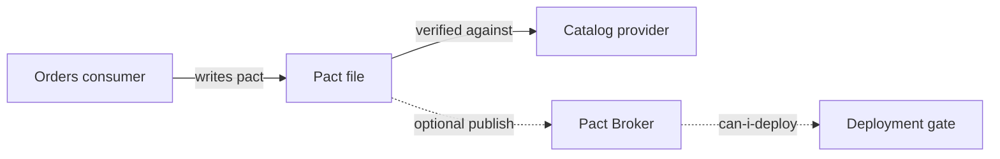

# Microservices Contract Testing Lab

[](https://github.com/foysal619/microservices-contract-testing-lab/actions/workflows/quality.yml)

A production-shaped, runnable example of consumer-driven contract testing between an **orders consumer** and a **catalog provider**. It catches incompatible API changes before integration or end-to-end environments become the bottleneck.

## What this demonstrates

- Pact V3 consumer contracts with flexible type matchers
- real provider verification with isolated provider-state setup
- Node.js unit/integration tests using the built-in test runner
- a local Pact Broker stack backed by PostgreSQL
- deterministic CI with least-privilege workflow permissions



## Run it

Requires Node.js 20+.

```bash
npm ci
npm test
```

The consumer test generates `pacts/orders-consumer-catalog-provider.json`; the provider test then starts the real HTTP service and verifies every interaction.

### Optional local broker

```bash
docker compose up -d
# Broker UI: http://localhost:9292
docker compose down
```

## Repository map

```text
services/catalog/server.mjs           real provider service
services/orders/client.mjs            consumer-side API client
tests/contract/consumer.pact.test.mjs contract generation
tests/contract/provider.verify.mjs    provider verification
tests/unit/catalog.test.mjs           integration safety net
docker-compose.yml                    optional Pact Broker + PostgreSQL
```

## Breaking-change exercise

Change `price` in the provider response from a number to a string. The provider may still look valid to a human, but verification fails because the consumer contract requires a decimal. This is the key value of contract testing: compatibility is checked where the change is made.

## Production evolution

In a delivery platform, publish pacts with the commit SHA and branch, verify deployed provider versions, record deployments, and place Pact Broker's `can-i-deploy` check before release promotion. Secrets belong in the CI secret store, never in this repository.

## License

MIT
